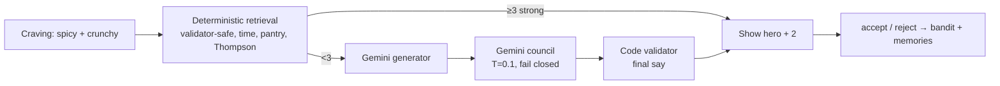

# EZ FOOD

**Eat the plan. Without thinking.** A gamified PWA that turns a 7-day anti-inflammatory, liver-friendly plan (psoriatic arthritis + fatty liver) into one tap at a time: morning activation, a meeting-aware schedule, step-by-step cooking mode, craving swaps, an on-the-go mode, and a learning loop. Gemini adds recipe ideas only behind a safety council and a code-level validator.

> EZ FOOD helps you follow the diet plan you and your doctor have chosen. It does not diagnose, treat, or replace medical advice.

## Coach chat (week 2 onwards)
- **Plan your next 7 days:** from day 6 of a week, Today shows a card that opens a short chat about your goal for the coming week (more energy, less cooking time, more variety…). The coach proposes a full week; you confirm it and it becomes Week 2, 3, …
- **Tell it anything:** "I'd like to drink alkaline water", "no onion", "make snacks crunchier". Each change appears as a card showing exactly what changes (before → after); nothing applies until you tap **Confirm**. Confirmed changes are listed in Settings → Your changes, where you can remove them.
- The eating window, banned foods and the fat cap can't be changed by chat; that's for your doctor.

## Run it locally

```bash
npm install
npm run build && npx next start -p 3710
```

Open http://localhost:3710. `.env.local` points at the Neon database (run `npm run db:migrate` after schema changes; `npm run db:tables` lists tables). With `DATABASE_URL` empty, data lives in a local Postgres (PGlite) at `.data/pglite` instead. Install to the home screen for the PWA (offline Today, recipes and cooking mode; push reminders).

| Command | What it does |
|---|---|
| `npm test` | 322 unit + property tests (validator, scheduler, prep pipeline, game, bandit, red flags, notifications) |
| `npm run typecheck` / `npm run lint` | TS strict / ESLint |
| `npm run db:generate` / `npm run db:migrate` | Drizzle migrations (Neon) |
| `NODE_OPTIONS=--conditions=react-server npx tsx scripts/ai-smoke.mts` | Live Gemini pipeline test (uses `.env.local`) |

## Environment (`.env.example`)
`DATABASE_URL(_UNPOOLED)` Neon · `AUTH_SECRET` · `LLM_PROVIDER` / `LLM_API_KEY` (OpenRouter) or `GEMINI_API_KEY` · `GEMINI_MODEL_FAST/REASONING` · `AI_DAILY_CALL_BUDGET` · `VAPID_*` · `CRON_SECRET` · `APP_URL` · `ADMIN_USER_REFS`. Secrets are server-only; nothing uses `NEXT_PUBLIC_`.

## Architecture

```
app/            Next.js 16 App Router: landing (/), onboarding, today, cook/[slug], plan, progress, learned, settings, admin, api/*
components/     UI (awmedia-style design system in app/globals.css + components/ui.tsx)
lib/safety/     banned-ingredient ontology, deterministic validator (final gate), red-flag detector
lib/engine/     scheduler (DFS + branch-and-bound), prep pipeline, Thompson bandit, craving retrieval, multi-week plans, personalisation rules, week planner
lib/game/       XP, levels, shielded consistency chain, quests, badges, Lucky Bowl
lib/ai/         Gemini transport (OpenRouter / Google), prompts v1, generator → council → validator pipeline, coach prompts + reply lint
lib/server/     user-scoped data access: today builder, actions, learning loop, notifications, account
lib/seed/       the 7-day plan (verbatim), 47 curated recipes, 193 interventions, pantry
public/sw.js    service worker: offline shell + data, Web Push with action buttons
```



## Deploy (not done yet, by request)
Neon is connected (ap-southeast-1) → copy the same env vars to Vercel (env vars, `vercel.json` sets `sin1` (next to Neon ap-southeast-1) + daily cron 20:00 IST) → GitHub secrets `CRON_SECRET` + `APP_URL` for `.github/workflows/tick.yml`.

See `docs/DECISIONS.md` for every trade-off and `docs/REVIEW_QUEUE.md` for what still needs a human.
